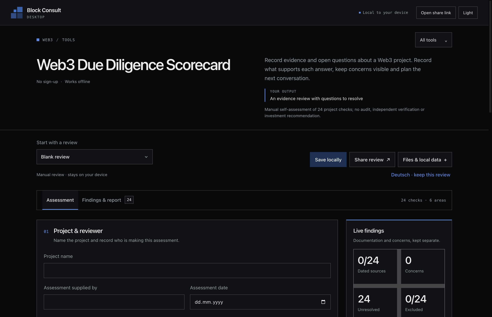
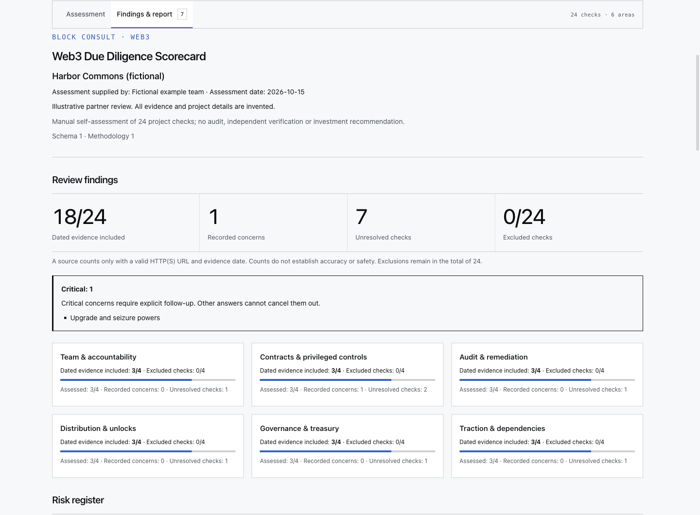

<a href="https://www.blockconsult.org">
  <picture>
    <source media="(prefers-color-scheme: dark)" srcset="public/blockconsult-logo.png">
    
  </picture>
</a>

# Web3 Due Diligence Scorecard

Review a Web3 project through 24 checks across six areas, from team accountability and contract controls to token distribution and governance. Record your assessment, dated sources and unresolved concerns, then prepare an evidence inventory and questions for the next review conversation.

An offline desktop tool from [Block Consult](https://www.blockconsult.org), available in English and German. For managing multiple cases, research and saved reports, see the separate [Block Consult DD workbench](https://github.com/blockconsult-org/block-consult-dd).

[](https://github.com/blockconsult-org/web3-due-diligence/releases/latest) [](LICENSE) · [Platform builds](https://github.com/blockconsult-org/web3-due-diligence/actions/workflows/release.yml)

**[Download for macOS or Windows](https://github.com/blockconsult-org/web3-due-diligence/releases/latest)** · [Use in your browser](https://www.blockconsult.org/tools/web3-due-diligence) · [Report an issue](https://github.com/blockconsult-org/web3-due-diligence/issues)



The assessment workspace keeps the current check and live findings together.

## What you can do

- Review 24 checks across team, contracts, audits, token distribution, governance and traction. Mark each as supported, a concern, unknown or not applicable.
- Attach source URLs, evidence dates, notes and your own source-review status. Excluded checks require a reason.
- Inspect dated evidence coverage, critical concerns and unresolved checks separately. The report includes an evidence inventory, risk register and prioritized follow-up questions.
- Save one review locally, move the full review between devices with JSON, export a PNG or PDF, or share a read-only snapshot with selected text and evidence fields.

Coverage measures documentation, not safety. The app does not fetch evidence, inspect contracts or independently verify a claim; a supported answer still needs a dated source and a recorded source review.

## Get started

1. Choose **Harbor Commons · fictional** under **Start with a review** to explore an example, or choose **Blank review** for your own project.
2. Enter the project and reviewer details. Select a review area, assess its checks and record the evidence behind each answer.
3. Open **Findings & report** to review concerns, evidence coverage and questions before proceeding.
4. Choose **Save locally** before closing. Use **Files & local data** for JSON and report exports, or **Share review** to preview a public snapshot.

## Screenshots



The fictional Harbor Commons report keeps its critical concern visible alongside evidence coverage. Example sources and project details are invented; they are not an assessment of a real project.

## Download and install

| Platform | Download | Installation |
| --- | --- | --- |
| macOS, Apple silicon and Intel | Universal `.dmg` | Open the disk image and drag the app to Applications. |
| Windows 11, Intel/AMD 64-bit | `windows-x64-setup.exe` | Run the per-user installer; administrator rights are not required. |
| Windows, portable | `windows-x64-portable.exe` | Run directly without installing. |

Release notes state the signing and notarization status of each download. Unsigned Windows releases may show a publisher warning. macOS requires macOS 13 or later. Check `SHA256SUMS.txt` against the downloaded file using `shasum -a 256` (macOS) or `Get-FileHash -Algorithm SHA256` (PowerShell). Download only from this repository's Releases page.

## Your data

- Calculations and editing work without an internet connection, account or API key.
- English/German UI, light/dark themes, keyboard controls and resizable layouts.
- Existing JSON models and browser share links remain compatible. Use **Open share link** to inspect a shared scenario locally.
- Exports use a native file-save dialog. **File → Save report as PDF** writes a local PDF.
- **Save locally** stores one review in this app's profile; saving again replaces that copy. Edits are not saved automatically. Export JSON for portable backups or to keep more than one review.
- No analytics, telemetry, cloud synchronization or automatic uploads. Website and evidence links open in your default browser. Unknown evidence destinations require confirmation.

Share links are readable, encoded snapshots, **not encrypted**. **Share review** lets you choose whether to include the project name, written context and evidence sources. Assessment states, exclusions and creator-reported counts remain in the snapshot. Review the preview before copying a link. Save or export before closing the app or using **Open share link**. Opening a link replaces the current workspace and can discard unsaved edits; it does not overwrite your saved local review.

## Run from source

Install Node.js 24 or newer, then:

```sh
git clone https://github.com/blockconsult-org/web3-due-diligence.git
cd web3-due-diligence
npm ci
npm run build
npm start
```

`npm run dev` runs the renderer in a browser. `npm test` checks the model and desktop security boundaries. `npm run test:desktop` launches real Electron and exercises offline rendering, themes, localization, exports and isolation. Run `npm run build` first.

```sh
npm run verify
npm run dist -- --mac --universal  # on macOS
npm run dist -- --win --x64       # on Windows
```

## Project layout

| Path | Responsibility |
| --- | --- |
| `tools/web3-due-diligence/` | Models, calculations, localized copy, UI and exports |
| `src/` | Desktop frame and small browser-framework adapters |
| `desktop/` | Sandboxed Electron host, local asset protocol, native PDF saving |
| `tests/` | Calculation regressions and real desktop integration checks |
| `.github/workflows/release.yml` | Tests and platform builds; draft releases for version tags |

## Release and maintenance

See the [release instructions](docs/RELEASING.md) for packaging and publishing. Releases are manual downloads; the app does not silently update. Keep the Electron runtime current when maintaining a fork.

This is a manual review aid, not an audit or investment recommendation. Source accuracy and the significance of each finding require professional judgement. Fixed follow-up priorities are not probabilities or estimates of financial loss.

## Contributing and license

Read the [contribution guide](CONTRIBUTING.md) before opening a pull request. Report vulnerabilities through the process in the [security policy](SECURITY.md).

[MIT](LICENSE) · Copyright © 2026 Block Consult GmbH. The license covers the code; it does not grant rights to use Block Consult’s name or logo as an endorsement.
